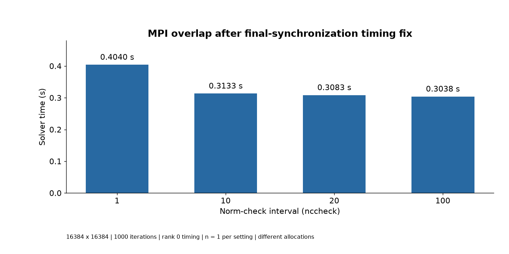

# Chapter 04: Overlap MPI communication and GPU computation

[English](README.en.md) | [简体中文](README.md) | [日本語](README.ja.md)

Record date: 2026-11-15 (America/Chicago). For reviewing and reproducing the experiments after the course. English translation: 2026-11-16.

[Return to the day's experiment index](../../../docs/experiments/2026-11-15/README.en.md) · [Read the missing information and screenshot checklist](../../../docs/experiments/2026-11-15/MISSING_INFORMATION.en.md)

## Follow-up — 2026-11-16

This page describes the November 15 evidence. The [November 16 research log](../../../research/2026-11-16/README.en.md) and [findings/status comparison](../../../research/2026-11-16/FINDINGS.en.md) add corrected validation and matched-reference measurements. Q1 and Q4 remain partial: single-row subdomains and same-implementation 1 PE/4 PE scaling are not yet tested. Historical source snapshots, timings and traces below remain unchanged.

## Findings and limits

The implementation completes CUDA-aware MPI boundary exchange and dependencies between streams. It also corrects synchronization when timing the end of the solve. Four logs preserve program summaries printed after numerical checks. Four-GPU time falls from 0.4040 s to 0.3038 s as `nccheck` changes from `1` to `100`.

These configurations come from different jobs, with one observation each. They do not establish a stable benefit. Numerical-check coverage is also incomplete: each rank's last row is excluded from the check loop. This report confirms only that the existing checks passed; it does not claim every row was validated.

## Implementation completed that day

Each process owns a set of grid rows and exchanges halos with neighboring processes. A halo contains boundary data needed by a neighboring subdomain. After boundary computation finishes, the host starts MPI exchange while interior computation can continue.

- **Communication and dependencies:** `MPI_Sendrecv` exchanges GPU buffers. Sending waits for the corresponding boundary event. See the [day's MPI source](archive/tasks/jacobi.cpp#L530).
- **End-of-solve timing:** The code waits for the interior computation stream before recording the end time. Synchronization stays outside the loop to preserve overlap opportunities in each iteration. See the [timing-correction snapshot](archive/results/timing_fix_20261115_213315/jacobi.cpp#L576).
- **Single-GPU timing:** The reference solver also waits for GPU completion before stopping the timer. See the [reference solver](archive/results/timing_fix_20261115_213315/jacobi.cpp#L778).

## Experiment conditions and results

The grid is 16384×16384, with at most 1000 iterations. Four processes use 4 GPUs. `nccheck` is the periodic norm-check interval. Non-CSV mode also checks for output every 100 iterations. The table uses rank 0 solve times and efficiencies printed in the logs. Efficiency divides by the GPU count multiplied by multi-GPU time.

| Configuration | nccheck | 1 GPU / s | 4 GPU / s | Program-printed efficiency / % |
|---|---:|---:|---:|---:|
| timing fix | 1 | 1.4737 | 0.4040 | 91.19 |
| timing fix | 10 | 1.2166 | 0.3133 | 97.09 |
| timing fix | 20 | 1.1969 | 0.3083 | 97.05 |
| timing fix | 100 | 1.1891 | 0.3038 | 97.84 |

The four bars come from separate jobs. No error bars from repeated measurements are available. See the [timing-correction results directory](archive/results/timing_fix_20261115_213315/) for original logs and hardware information.

## How to recheck

Completed task source files are in [archive/tasks](archive/tasks/), alongside the Makefile. In the course environment, build there and run `srun --cpu-bind=sockets -n 4 ./jacobi -nx 16384 -ny 16384 -niter 1000 -nccheck 10`. Obtain a valid Slurm allocation first.

The archive also preserves 6 groups totaling 24 Nsight reports. One group corresponds to corrected `nccheck=10`. Earlier report parameters appear only partly in filenames; names alone cannot recover their full launch arguments. See the shared [profiles.csv](../../../docs/experiments/2026-11-15/data/profiles.csv) for full paths.

## What remains to be added

The [check loop](archive/results/timing_fix_20261115_213315/jacobi.cpp#L596) uses `iy < iy_end_global`. The [boundary definition](archive/results/timing_fix_20261115_213315/jacobi.cpp#L207) defines that value as the last valid row index. Future work should check that row and non-finite values, then repeat measurements in one allocation. This new experiment was not completed during the current review.

Timeline screenshots of computation, MPI calls, and wait events at the same scale are also needed to show overlap intervals directly. Existing data does not provide an exact overlap percentage.
