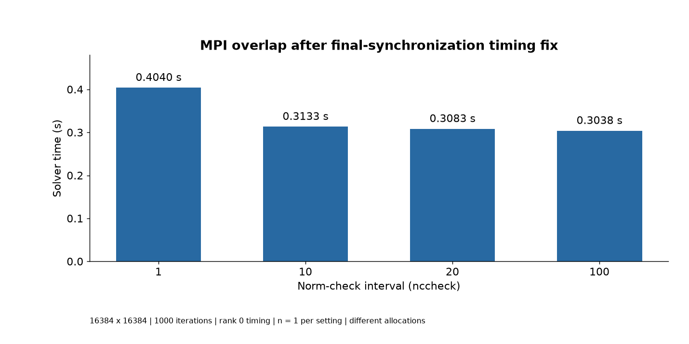

# 第 04 章：MPI 通信と GPU 計算の重なり

[English](README.en.md) | [简体中文](README.md) | [日本語](README.ja.md)

記録日：2026-11-15（America/Chicago）。翻訳日：2026-11-16。講習後の復習と実験の再現に使う資料です。

[当日の実験索引に戻る](../../../docs/experiments/2026-11-15/README.ja.md) · [不足情報とスクリーンショットの一覧を見る](../../../docs/experiments/2026-11-15/MISSING_INFORMATION.ja.md)

## 追加研究 — 2026-11-16

本ページは 11 月 15 日の証拠を記述しています。[11 月 16 日の研究記録](../../../research/2026-11-16/README.ja.md)と[知見・状態の照合](../../../research/2026-11-16/FINDINGS.ja.md)に、修正後の厳密検証と基準形状をそろえた測定があります。1 行の部分領域と同じ実装の 1 PE/4 PE 強スケーリングが未測定のため、Q1/Q4 は一部完了です。以下の過去のソース、時間、trace は変更していません。

## 結論と制約

CUDA-aware MPI の境界交換とストリーム間の依存関係を補完し、ソルバー終了時の同期と計時を修正しました。4 組のログには、数値検査後のプログラム集計出力が残っています。`nccheck=1` から `100` に変えると、4 GPU の実行時間は 0.4040 s から 0.3038 s に減りました。

各構成は別のジョブで実行し、各組の記録は 1 回だけです。これだけでは安定した効果とは判断できません。また、ソースコードの数値検査は各 rank の最終行を検査ループに含めていません。そのため、この報告が確認するのは既存の検査に合格したことだけであり、全行の検証完了は主張しません。

## 当日完成した実装

各プロセスは格子の一部の行を担当し、隣接プロセスと halo、つまり隣接する部分領域で必要な境界データを交換します。境界計算の完了後、ホストが MPI 交換を開始します。その間も内部領域の計算を続けられます。

- **通信と依存関係：** `MPI_Sendrecv` で GPU バッファを交換し、送信前に対応する境界イベントを待ちます。[当日の MPI ソースコード](archive/tasks/jacobi.cpp#L530) を参照してください。
- **ソルバー終了時の計時：** 終了時刻を記録する前に、内部計算ストリームを待ちます。この同期はループ外に置き、各反復で計算と通信を重ねる余地を保っています。[計時修正のスナップショット](archive/results/timing_fix_20261115_213315/jacobi.cpp#L576) を参照してください。
- **単一 GPU の計時：** 基準ソルバーも計時終了前に GPU の完了を待ちます。[基準ソルバー](archive/results/timing_fix_20261115_213315/jacobi.cpp#L778) を参照してください。

## 実験条件と結果

格子は 16384×16384、最大 1000 回反復で、4 プロセスが 4 GPU をそれぞれ使います。`nccheck` は定期的なノルム確認間隔です。非 CSV モードでは、100 回反復するごとの表示用にも確認します。表は、ログに表示された rank 0 のソルバー実行時間と効率です。効率の分母は GPU 数とマルチ GPU 時間の積です。

| 構成 | nccheck | 1 GPU / s | 4 GPU / s | プログラムの表示効率 / % |
|---|---:|---:|---:|---:|
| timing fix | 1 | 1.4737 | 0.4040 | 91.19 |
| timing fix | 10 | 1.2166 | 0.3133 | 97.09 |
| timing fix | 20 | 1.1969 | 0.3083 | 97.05 |
| timing fix | 100 | 1.1891 | 0.3038 | 97.84 |

図の 4 組の棒は別々のジョブに基づき、反復測定の誤差棒はありません。元ログとハードウェア情報は [計時修正の結果ディレクトリ](archive/results/timing_fix_20261115_213315/) を参照してください。

## 再確認する方法

課題を完成させたソースファイルは [archive/tasks](archive/tasks/) にあり、同じディレクトリに Makefile も保存しています。講習環境があれば、そのディレクトリでコンパイルし、`srun --cpu-bind=sockets -n 4 ./jacobi -nx 16384 -ny 16384 -niter 1000 -nccheck 10` を実行できます。先に有効な Slurm リソース割り当てを取得してください。

Nsight レポートは別途 6 組、計 24 件保存しています。うち 1 組は修正後の `nccheck=10` に対応します。初期レポートの引数は、ファイル名に一部が示されるだけです。名前だけから実行引数を補ってはいけません。完全なパスは共通の [profiles.csv](../../../docs/experiments/2026-11-15/data/profiles.csv) にあります。

## 次に補うべき項目

[検査ループ](archive/results/timing_fix_20261115_213315/jacobi.cpp#L596) は `iy < iy_end_global` を使っています。一方、[境界定義](archive/results/timing_fix_20261115_213315/jacobi.cpp#L207) では `iy_end_global` を最後の有効行インデックスとしています。今後はこの行と非有限値の検査を追加し、同じリソース割り当てで反復測定する必要があります。これは今回の整理で完了した新しい実験ではありません。

通信と計算が重なる区間を直接示すには、同じ時間尺度で計算、MPI 呼び出し、待機イベントを示すタイムラインのスクリーンショットも必要です。現データからは正確な重なり率は得られていません。
