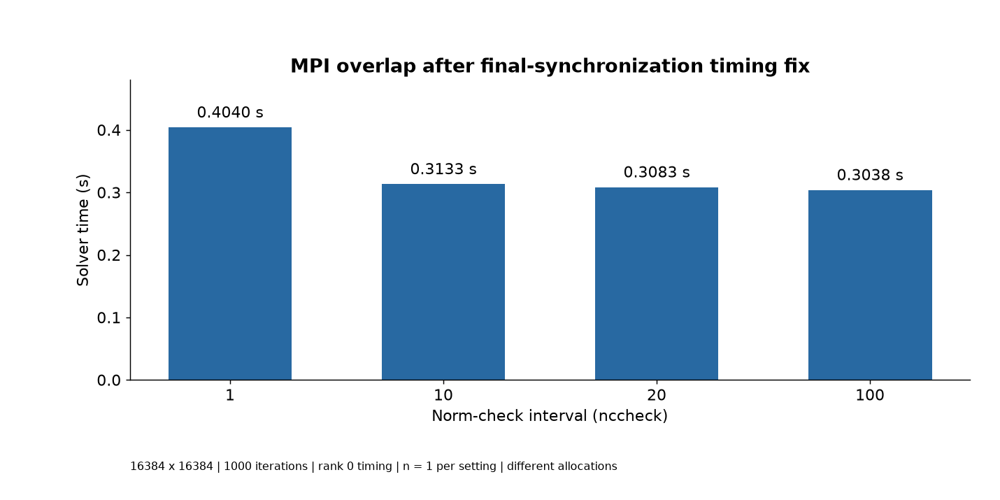

# 第 04 章：重叠 MPI 通信与 GPU 计算

[English](README.en.md) | [简体中文](README.md) | [日本語](README.ja.md)

记录日期：2026-11-15（America/Chicago）。供课后复习与复现实验使用。

[返回当天实验索引](../../../docs/experiments/2026-11-15/README.md) · [查看待补信息与截图清单](../../../docs/experiments/2026-11-15/MISSING_INFORMATION.md)

## 后续研究 — 2026-11-16

本页描述 11 月 15 日的证据。[11 月 16 日研究日志](../../../research/2026-11-16/README.md)及[发现/状态对照](../../../research/2026-11-16/FINDINGS.md)补充了严格验证与匹配参考测量。Q1、Q4 仍为部分完成：单行子域与同实现 1 PE/4 PE 强扩展尚未测试。下方历史源码快照、耗时与 trace 保持原样。

## 结论与限制

已补齐 CUDA-aware MPI 的边界交换和流间依赖，并修正求解结束时的同步计时。四组日志保留了数值检查后的程序汇总。`nccheck=1` 到 `100` 的四 GPU 耗时由 0.4040 s 降至 0.3038 s。

这些配置来自不同作业，每组只有一次记录，不能据此认定稳定收益。源码还存在数值检查覆盖不足：每个 rank 的最后一行未进入检查循环。因此，本报告只确认已有检查通过，不声称完成了逐行验证。

## 当天完成的实现

每个进程负责网格的一段行，并与相邻进程交换 halo，即相邻子域需要的边界数据。边界计算完成后，主机发起 MPI 交换；内部区域计算可以继续执行。

- **通信与依赖：** 使用 `MPI_Sendrecv` 交换 GPU 缓冲区；发送前等待对应边界事件。见 [当天 MPI 源码](archive/tasks/jacobi.cpp#L530)。
- **求解结束计时：** 在记录结束时间前等待内部计算流。该同步放在循环外，保留每轮的重叠机会。见 [计时修正快照](archive/results/timing_fix_20261115_213315/jacobi.cpp#L576)。
- **单 GPU 计时：** 参考求解器同样在停止计时前等待 GPU 完成。见 [参考求解器](archive/results/timing_fix_20261115_213315/jacobi.cpp#L778)。

## 实验条件和结果

网格为 16384×16384，最多 1000 次迭代，4 个进程分别使用 4 张 GPU。`nccheck` 表示周期性的范数检查间隔；非 CSV 模式还会为每 100 轮的打印执行检查。下表使用日志打印的 rank 0 求解时间和效率；效率的分母为 GPU 数乘以多 GPU 时间。

| 配置 | nccheck | 1 GPU / s | 4 GPU / s | 程序打印效率 / % |
|---|---:|---:|---:|---:|
| timing fix | 1 | 1.4737 | 0.4040 | 91.19 |
| timing fix | 10 | 1.2166 | 0.3133 | 97.09 |
| timing fix | 20 | 1.1969 | 0.3083 | 97.05 |
| timing fix | 100 | 1.1891 | 0.3038 | 97.84 |

图中四组柱形来自独立作业，未提供重复测量误差条。原始日志和硬件信息见 [计时修正结果目录](archive/results/timing_fix_20261115_213315/)。

## 如何复查

完成任务的源文件位于 [archive/tasks](archive/tasks/)，同目录保存 Makefile。已有课程环境中，可在该目录编译后运行 `srun --cpu-bind=sockets -n 4 ./jacobi -nx 16384 -ny 16384 -niter 1000 -nccheck 10`。应先取得有效的 Slurm 资源分配。

另保存了 6 组、24 份 Nsight 报告，其中一组对应修正后的 `nccheck=10`。较早报告的参数只部分体现在文件名中，不能仅凭名称给它们补写运行参数。完整路径见公共 [profiles.csv](../../../docs/experiments/2026-11-15/data/profiles.csv)。

## 接下来需要补齐

[检查循环](archive/results/timing_fix_20261115_213315/jacobi.cpp#L596) 使用 `iy < iy_end_global`，而 [边界定义](archive/results/timing_fix_20261115_213315/jacobi.cpp#L207) 将它定义为最后一个有效行索引。后续应补查这一行及非有限值，并在相同资源分配中重复测量；这不是本次整理中已经完成的新实验。

还需要同一尺度下的计算、MPI 调用和等待事件时间线截图，才能直接展示通信与计算重叠的区间。现有数据未给出精确的重叠比例。
