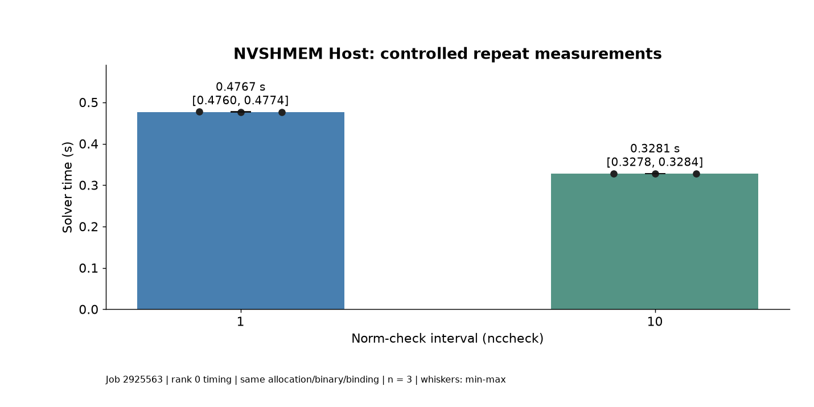

# Chapter 07: NVSHMEM Host API and timing anomaly recheck

[English](nvshmem-host.en.md) | [简体中文](nvshmem-host.md) | [日本語](nvshmem-host.ja.md)

Record date: 2026-11-15 (America/Chicago). For reviewing and reproducing the experiments after the course. English translation: 2026-11-16.

[Return to the day's experiment index](../../../docs/experiments/2026-11-15/README.en.md) · [Read the missing information and screenshot checklist](../../../docs/experiments/2026-11-15/MISSING_INFORMATION.en.md)

## Findings and limits

An early `nccheck=10` log records a four-GPU solve time of 2.4381 s. Later, each setting was measured 3 times within one job, using the same program and CPU binding. Median time was 0.4767 s for `nccheck=1` and 0.3281 s for `nccheck=10`. The later controlled experiment did not reproduce the early slowdown.

The current conclusion is therefore that the anomaly did not recur under these controlled conditions. Its cause cannot yet be assigned to CPU binding, host submission cadence, or internal NVSHMEM mechanisms. The 2.4381 s value also cannot represent typical performance of this implementation.

## Implementation and experiment design

NVSHMEM provides symmetric memory and one-sided access. A sender can write to the corresponding buffer on another processing element (PE). Here, the host submits boundary puts to a CUDA stream, completes quiet on the communication stream, and connects the interior computation stream through events. An all-participant barrier runs before the next iteration uses the data.

See [boundary puts and completion order](archive/tasks/NVSHMEM/jacobi.cu#L386) and the [barrier before the next iteration](archive/tasks/NVSHMEM/jacobi.cu#L406). The code already calls [cudaDeviceSynchronize](archive/tasks/NVSHMEM/jacobi.cu#L429) before stopping the timer. Chapter 04's timing issue therefore cannot directly explain this anomaly.

The controlled experiment used job 2925563, node jpbo-003-46, 4 GH200 GPUs, a 16384×16384 grid, 1000 iterations, and sockets CPU binding. The sequence was `1,10,10,1,1,10`, with 3 observations per configuration. Synchronization policy was unchanged, and profiling was disabled.

## Preserved measurements

| Configuration | nccheck | 1 GPU / s | 4 GPU / s | Program-printed efficiency / % |
|---|---:|---:|---:|---:|
| controlled | 1 | 1.6960 | 0.4774 | 88.81 |
| controlled | 1 | 1.6825 | 0.4760 | 88.37 |
| controlled | 1 | 1.6835 | 0.4767 | 88.29 |
| controlled | 10 | 1.2357 | 0.3284 | 94.07 |
| controlled | 10 | 1.2359 | 0.3281 | 94.17 |
| controlled | 10 | 1.2354 | 0.3278 | 94.23 |

Each point represents one measurement. The median, minimum, and maximum describe only these 3 results. The range is 0.4760–0.4774 s for `nccheck=1` and 0.3278–0.3284 s for `10`. Original times are rank 0's printed values. The maximum solve time across all ranks was not recorded.

All six `srun` commands exited with code 0 and printed solver results that follow the existing numerical checks. See the [controlled runs.tsv](archive/tasks/results/20261115T221656Z_nvshmem-nccheck-controlled_job2925563/runs.tsv) and adjacent logs.

## Early anomaly and reproduction materials

The [early nccheck=10 log](archive/tasks/results/nvshmem_benchmark/nccheck_10.log) records 2.4381 s from job 2925303. Archived experiment notes also record 0.4770 s for `nccheck=1` in another job, but its complete log was not found. Their ratio is about 5.11. They come from different allocations and cannot establish causation.

The [controlled experiment directory](archive/tasks/results/20261115T221656Z_nvshmem-nccheck-controlled_job2925563/) preserves scripts, source snapshots, environment, and build logs. The [4 early Nsight reports](archive/tasks/results/nvshmem_profiles/) in another directory belong to different runs from these 6 controlled measurements.

## Follow-up questions

First, try reproducing the anomaly within the same allocation while recording each rank's time and placement. Only if it recurs, fix the norm-check frequency and vary only host synchronization cadence to observe whether time changes. The current archive contains neither this ablation nor evidence for a specific root cause.
