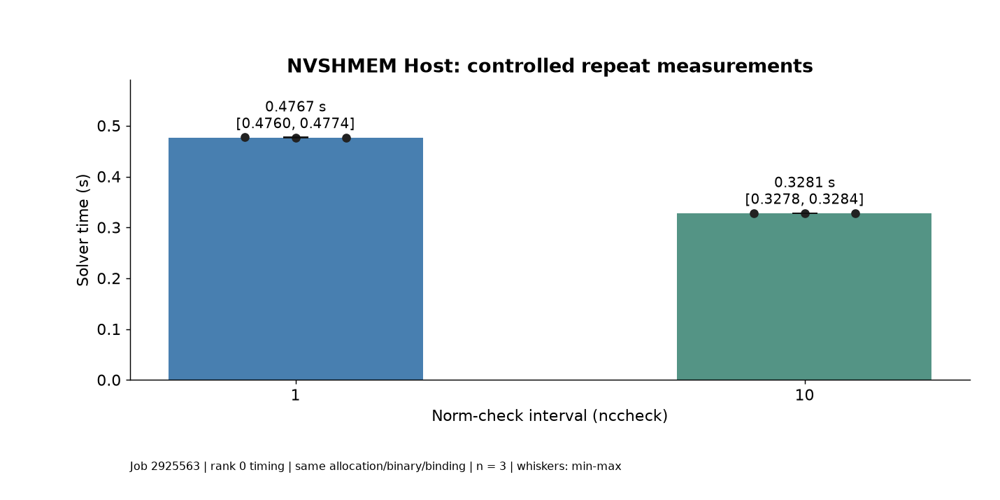

# 第 07 章：NVSHMEM Host API と実行時間異常の再確認

[English](nvshmem-host.en.md) | [简体中文](nvshmem-host.md) | [日本語](nvshmem-host.ja.md)

記録日：2026-11-15（America/Chicago）。翻訳日：2026-11-16。講習後の復習と実験の再現に使う資料です。

[当日の実験索引に戻る](../../../docs/experiments/2026-11-15/README.ja.md) · [不足情報とスクリーンショットの一覧を見る](../../../docs/experiments/2026-11-15/MISSING_INFORMATION.ja.md)

## 結論と制約

初期の `nccheck=10` のログには、4 GPU のソルバー実行時間 2.4381 s が記録されています。その後、同一ジョブ、同一プログラム、同じ CPU バインド条件で各 3 回測定しました。`nccheck=1` の中央値は 0.4767 s、`nccheck=10` は 0.3281 s でした。後続の条件をそろえた実験では、初期の低速な結果を再現できませんでした。

したがって、現在の結論は「この組の制御条件下では異常を再現できなかった」です。原因を CPU バインド、ホストの処理投入周期、NVSHMEM 内部の仕組みに帰すことはまだできません。2.4381 s をこの実装の典型的な性能と見なすこともできません。

## 実装と実験設計

NVSHMEM は対称メモリと片側アクセスを提供し、送信側が別の処理要素（PE）の対応バッファに書き込めます。この実装では、ホストが CUDA ストリームに境界 put を投入します。通信ストリームで quiet を完了した後、イベントで内部計算ストリームにつなぎ、次の反復でデータを使う前に全体 barrier を実行します。

関連コードは [境界 put と完了順序](archive/tasks/NVSHMEM/jacobi.cu#L386)、[次の反復前の barrier](archive/tasks/NVSHMEM/jacobi.cu#L406) にあります。計時終了前には既に [cudaDeviceSynchronize](archive/tasks/NVSHMEM/jacobi.cu#L429) を実行しています。そのため、第 04 章の計時問題をそのままこの異常の説明に使うことはできません。

条件をそろえた実験は、ジョブ 2925563、ノード jpbo-003-46 で実行しました。GH200 を 4 GPU、格子 16384×16384、1000 回反復、CPU バインドは sockets です。順序は `1,10,10,1,1,10` で、各構成を 3 回ずつ測定しました。この実験では同期方針を変更せず、profiling も有効にしていません。

## 保存した測定結果

| 構成 | nccheck | 1 GPU / s | 4 GPU / s | プログラムの表示効率 / % |
|---|---:|---:|---:|---:|
| controlled | 1 | 1.6960 | 0.4774 | 88.81 |
| controlled | 1 | 1.6825 | 0.4760 | 88.37 |
| controlled | 1 | 1.6835 | 0.4767 | 88.29 |
| controlled | 10 | 1.2357 | 0.3284 | 94.07 |
| controlled | 10 | 1.2359 | 0.3281 | 94.17 |
| controlled | 10 | 1.2354 | 0.3278 | 94.23 |

図の各点は 1 回の測定です。中央値と最小値・最大値が記述するのは、この 3 回の結果だけです。`nccheck=1` の範囲は 0.4760–0.4774 s、`10` は 0.3278–0.3284 s です。元の時間は rank 0 の表示値で、全 rank の最大ソルバー実行時間は記録していません。

6 回の実行すべてで `srun` の終了コードは 0 でした。いずれも、元の数値検査後にだけソルバーが表示する結果を出力しています。根拠は [条件をそろえた実験の runs.tsv](archive/tasks/results/20261115T221656Z_nvshmem-nccheck-controlled_job2925563/runs.tsv) と同じディレクトリのログを参照してください。

## 初期の異常と再現用資料

[初期の nccheck=10 ログ](archive/tasks/results/nvshmem_benchmark/nccheck_10.log) は、ジョブ 2925303 の 2.4381 s を記録しています。保存した実験説明には、別ジョブの `nccheck=1` が 0.4770 s だったとの記録もありますが、対応する完全なログは見つかっていません。2 つの値の比は約 5.11 です。同じリソース割り当てで得た値ではないため、因果関係は示せません。

[条件をそろえた実験のディレクトリ](archive/tasks/results/20261115T221656Z_nvshmem-nccheck-controlled_job2925563/) には、スクリプト、元ソースのスナップショット、環境、ビルドログを保存しています。別のディレクトリにある [初期の Nsight レポート 4 件](archive/tasks/results/nvshmem_profiles/) は、この 6 回の測定とは別の実行です。

## 今後の課題

まず同じリソース割り当てで再現を試み、各 rank の時間と placement を記録します。異常を繰り返し再現できた場合にだけ、ノルム確認頻度を固定してホストの同期周期だけを変え、実行時間が変わるか確認します。現在の保存資料には、この切り分け実験も、具体的な根本原因を裏付ける根拠もありません。
