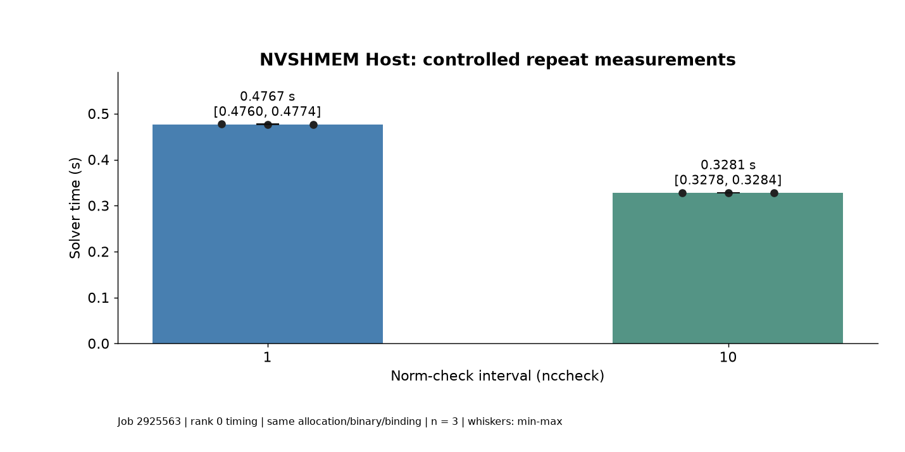

# 第 07 章：NVSHMEM Host API 与耗时异常复查

[English](nvshmem-host.en.md) | [简体中文](nvshmem-host.md) | [日本語](nvshmem-host.ja.md)

记录日期：2026-11-15（America/Chicago）。供课后复习与复现实验使用。

[返回当天实验索引](../../../docs/experiments/2026-11-15/README.md) · [查看待补信息与截图清单](../../../docs/experiments/2026-11-15/MISSING_INFORMATION.md)

## 结论与限制

早期 `nccheck=10` 日志记录了 2.4381 s 的四 GPU 求解时间。随后在同一作业、同一程序和相同 CPU 绑定条件下，各测 3 次：`nccheck=1` 的中位数为 0.4767 s，`nccheck=10` 为 0.3281 s。后续受控实验没有复现早期的慢速结果。

因此，当前结论是“异常未在这组受控条件下复现”。尚不能将原因归为 CPU 绑定、主机提交节奏或 NVSHMEM 内部机制。更不能将 2.4381 s 作为该实现的典型性能。

## 实现和实验设计

NVSHMEM 提供对称内存及单边访问；发送方可以写入另一处理单元（PE）的对应缓冲区。本实现由主机向 CUDA 流提交边界 put，在通信流中完成 quiet，再通过事件连接内部计算流，并在下一轮使用数据前执行全体 barrier。

相关代码见 [边界 put 与完成顺序](archive/tasks/NVSHMEM/jacobi.cu#L386) 和 [下一轮前的 barrier](archive/tasks/NVSHMEM/jacobi.cu#L406)。停止计时前已经执行 [cudaDeviceSynchronize](archive/tasks/NVSHMEM/jacobi.cu#L429)，因此不能直接套用第 04 章的计时问题解释异常。

受控实验使用作业 2925563、节点 jpbo-003-46，4 张 GH200、16384×16384 网格、1000 次迭代，CPU 绑定为 sockets。顺序为 `1,10,10,1,1,10`，每种配置各 3 次。未在此实验中修改同步策略，也未启用 profiling。

## 保留的测量结果

| 配置 | nccheck | 1 GPU / s | 4 GPU / s | 程序打印效率 / % |
|---|---:|---:|---:|---:|
| controlled | 1 | 1.6960 | 0.4774 | 88.81 |
| controlled | 1 | 1.6825 | 0.4760 | 88.37 |
| controlled | 1 | 1.6835 | 0.4767 | 88.29 |
| controlled | 10 | 1.2357 | 0.3284 | 94.07 |
| controlled | 10 | 1.2359 | 0.3281 | 94.17 |
| controlled | 10 | 1.2354 | 0.3278 | 94.23 |

图中每个点表示一次测量；中位数与最小、最大值仅描述这 3 次结果。`nccheck=1` 的范围为 0.4760–0.4774 s；`10` 为 0.3278–0.3284 s。原始时间是 rank 0 的打印值，未记录所有 rank 的最大求解时间。

六次运行的 `srun` 退出码均为 0，并输出求解器在原有数值检查后才打印的结果。证据见 [受控 runs.tsv](archive/tasks/results/20261115T221656Z_nvshmem-nccheck-controlled_job2925563/runs.tsv) 及相邻日志。

## 早期异常与复现材料

[早期 nccheck=10 日志](archive/tasks/results/nvshmem_benchmark/nccheck_10.log) 记录作业 2925303 的 2.4381 s。归档实验说明还记载另一作业的 `nccheck=1` 为 0.4770 s，但对应完整日志未找到。两数相除约为 5.11；它们不来自同一资源分配，不能建立因果关系。

[受控实验目录](archive/tasks/results/20261115T221656Z_nvshmem-nccheck-controlled_job2925563/) 保存了脚本、来源快照、环境和构建日志。另一目录的 [4 份早期 Nsight 报告](archive/tasks/results/nvshmem_profiles/) 与这 6 次受控测量不是同一批运行。

## 后续问题

先尝试在相同资源分配中再次复现，并记录各 rank 耗时和 placement。只有异常可重复时，再固定范数检查频率，仅改变主机同步节奏，观察耗时是否随之变化。当前归档没有这项消融实验，也没有支持具体根因的证据。
