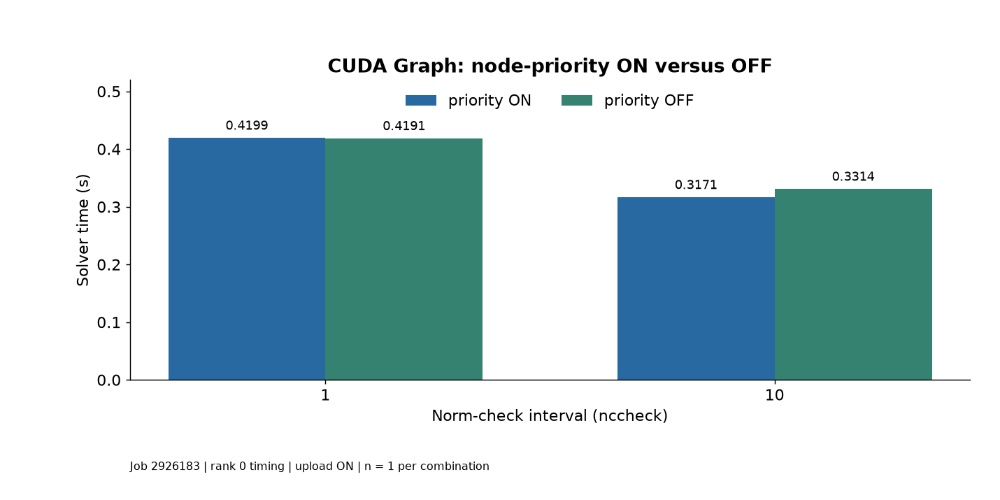

# Chapter 09: Compare CUDA Graph node priority

[English](cuda-graphs.en.md) | [简体中文](cuda-graphs.md) | [日本語](cuda-graphs.ja.md)

Record date: 2026-11-15 (America/Chicago). For reviewing and reproducing the experiments after the course. English translation: 2026-11-16.

[Return to the day's experiment index](../../../docs/experiments/2026-11-15/README.en.md) · [Read the missing information and screenshot checklist](../../../docs/experiments/2026-11-15/MISSING_INFORMATION.en.md)

## Findings and limits

Within one job, `nccheck=10` took 0.3171 s with node priority enabled and 0.3314 s with it disabled. This single observation shows about 4.32% less elapsed time. At `nccheck=1`, the enabled value of 0.4199 s was slightly higher than the disabled value of 0.4191 s.

Each combination has only one formal measurement, so a stable priority benefit is unconfirmed. “Elapsed-time reduction” here uses the disabled configuration as its denominator. It is not the percentage increase in throughput.

## Implementation completed that day

CUDA Graph captures dependent GPU work as a graph, then launches it repeatedly to reduce host overhead from individual submissions. This implementation keeps 4 graphs for the combinations of norm computation and double-buffer parity. Events connect boundary computation, NCCL communication, and interior computation.

The [instantiation code](archive/tasks/Using_CUDA_Graphs/jacobi.cpp#L360) controls node priority through `cudaGraphInstantiateFlagUseNodePriority`. `-no_node_priority` disables it. Both formal configurations enable [graph upload](archive/tasks/Using_CUDA_Graphs/jacobi.cpp#L375). Each iteration selects and launches the appropriate graph; see the [loop source](archive/tasks/Using_CUDA_Graphs/jacobi.cpp#L398).

## Formal measurements and failed runs

Formal results come from job 2926183 on the same node, jpbo-001-09, with 4 GH200 GPUs, a 16384×16384 grid, 1000 iterations, and sockets binding. For each priority configuration, the registry marks both benchmarks and one short trace with exit code 0 and PASS.

| Configuration | nccheck | 1 GPU / s | 4 GPU / s | Program-printed efficiency / % |
|---|---:|---:|---:|---:|
| priority ON | 1 | 1.4677 | 0.4199 | 87.39 |
| priority ON | 10 | 1.2092 | 0.3171 | 95.34 |
| priority OFF | 1 | 1.4665 | 0.4191 | 87.47 |
| priority OFF | 10 | 1.2097 | 0.3314 | 91.26 |

The figure has no error bars because there are no repeated measurements. Data comes from the [priority ON results](archive/tasks/results/20261115T231315Z_nccl-graph_priority1_upload1_job2926183/) and [priority OFF results](archive/tasks/results/20261115T231410Z_nccl-graph_priority0_upload1_job2926183/). Timing covers the rank 0 solve, excluding initialization, graph construction, and the full Slurm step.

Earlier ON/OFF attempts in job 2925563 failed because their allocation expired. All 6 benchmark/profile steps across these two groups exited with code 1 and provide no valid performance data. See the [failed ON registry](archive/tasks/results/20261115T230034Z_nccl-graph_priority1_upload1_job2925563/runs.tsv) and [failed OFF registry](archive/tasks/results/20261115T230049Z_nccl-graph_priority0_upload1_job2925563/runs.tsv).

## How to recheck and continue measuring

The final [run_experiment.sh](archive/tasks/Using_CUDA_Graphs/run_experiment.sh) and each group's `source/` snapshot preserve the actual options. The script requires the course environment and a valid allocation. Read it and adapt it to your cluster before use. This review did not execute these cluster scripts.

Next, alternate ON/OFF within one job and repeat `ON,OFF,OFF,ON`. Calculate medians, spread, and paired differences for each of the two check intervals. Node-level ON/OFF screenshots at the same time scale are also needed to check relative launch order of boundary, NCCL, and interior kernels. Existing traces cover 4 ranks per configuration, totaling 8 files.
