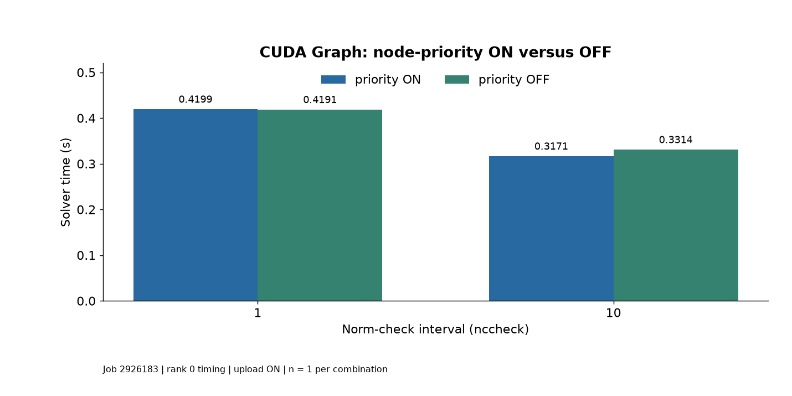

# 第 09 章：CUDA Graph のノード優先度の比較

[English](cuda-graphs.en.md) | [简体中文](cuda-graphs.md) | [日本語](cuda-graphs.ja.md)

記録日：2026-11-15（America/Chicago）。翻訳日：2026-11-16。講習後の復習と実験の再現に使う資料です。

[当日の実験索引に戻る](../../../docs/experiments/2026-11-15/README.ja.md) · [不足情報とスクリーンショットの一覧を見る](../../../docs/experiments/2026-11-15/MISSING_INFORMATION.ja.md)

## 結論と制約

同一ジョブの `nccheck=10` では、ノード優先度を有効にした実行時間が 0.3171 s、無効が 0.3314 s でした。単回測定での実行時間減少は約 4.32% です。`nccheck=1` では、有効時の 0.4199 s が無効時の 0.4191 s をわずかに上回りました。

各組み合わせの正式測定は 1 回だけです。そのため、優先度が安定した効果をもたらすかは未確認です。ここでいう「実行時間減少」は無効構成の値を分母にしており、スループットの向上率とは異なります。

## 当日完成した実装

CUDA Graph は依存関係のある GPU 処理をグラフとしてキャプチャし、繰り返し起動することで、個別に処理を投入するホスト側のオーバーヘッドを減らします。この実装では「ノルム計算の有無」と「ダブルバッファの奇数・偶数」を組み合わせた 4 種類のグラフを保持します。イベントで境界計算、NCCL 通信、内部計算をつないでいます。

[インスタンス化コード](archive/tasks/Using_CUDA_Graphs/jacobi.cpp#L360) は `cudaGraphInstantiateFlagUseNodePriority` でノード優先度を制御します。`-no_node_priority` で無効にします。正式測定の両構成とも [graph upload](archive/tasks/Using_CUDA_Graphs/jacobi.cpp#L375) は有効です。各反復では対応するグラフを選んで起動します。[ループのソースコード](archive/tasks/Using_CUDA_Graphs/jacobi.cpp#L398) を参照してください。

## 正式測定と失敗記録

正式結果はジョブ 2926183、同じノード jpbo-001-09 で得たものです。GH200 を 4 GPU、格子 16384×16384、1000 回反復、sockets バインドで実行しました。各構成の benchmark 2 回と短い trace 1 回は、registry に終了コード 0、PASS と記録されています。

| 構成 | nccheck | 1 GPU / s | 4 GPU / s | プログラムの表示効率 / % |
|---|---:|---:|---:|---:|
| priority ON | 1 | 1.4677 | 0.4199 | 87.39 |
| priority ON | 10 | 1.2092 | 0.3171 | 95.34 |
| priority OFF | 1 | 1.4665 | 0.4191 | 87.47 |
| priority OFF | 10 | 1.2097 | 0.3314 | 91.26 |

反復測定がないため、図には誤差棒がありません。データは [priority ON の結果](archive/tasks/results/20261115T231315Z_nccl-graph_priority1_upload1_job2926183/) と [priority OFF の結果](archive/tasks/results/20261115T231410Z_nccl-graph_priority0_upload1_job2926183/) に基づきます。計時対象は rank 0 のソルバー実行時間で、初期化、グラフ構築、Slurm step 全体の時間は含みません。

それ以前のジョブ 2925563 の ON/OFF 実行は、どちらもリソース割り当ての期限切れで失敗しました。2 組、計 6 件の benchmark/profile step の終了コードは 1 で、有効な性能データにはなりません。[失敗した ON の registry](archive/tasks/results/20261115T230034Z_nccl-graph_priority1_upload1_job2925563/runs.tsv) と [失敗した OFF の registry](archive/tasks/results/20261115T230049Z_nccl-graph_priority0_upload1_job2925563/runs.tsv) を参照してください。

## 再確認と追加測定の方法

最終版の [run_experiment.sh](archive/tasks/Using_CUDA_Graphs/run_experiment.sh) と各組の `source/` スナップショットに、実際のオプションを保存しています。スクリプトは講習環境と有効なリソース割り当てを先に設定する必要があります。内容を読み、使用するクラスタの条件に合わせてください。今回の整理では、これらのクラスタ用スクリプトは実行していません。

次は同一ジョブで ON/OFF を交互に実行し、`ON,OFF,OFF,ON` を繰り返します。2 種類のノルム確認間隔それぞれについて、中央値、ばらつき、対応のある差を集計します。同じ時間尺度の ON/OFF のノード単位のスクリーンショットも必要です。境界、NCCL、内部 kernel の相対的な起動順を確認します。既存 trace は各 4 rank、計 8 件です。
