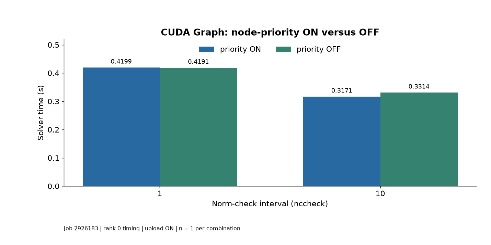

# 第 09 章：CUDA Graph 节点优先级对照

记录日期：2026-11-15（America/Chicago）。供课后复习与复现实验使用。

[返回当天实验索引](../../../docs/experiments/2026-11-15/README.md) · [查看待补信息与截图清单](../../../docs/experiments/2026-11-15/MISSING_INFORMATION.md)

## 结论与限制

在同一作业中，`nccheck=10` 时启用节点优先级的耗时为 0.3171 s，关闭时为 0.3314 s，单次观测耗时减少约 4.32%。`nccheck=1` 时，启用值为 0.4199 s，反而略高于关闭值 0.4191 s。

每种组合只有一次正式测量，因此尚不能确认优先级带来稳定收益。这里的“耗时减少”以关闭配置为分母，也不等同于吞吐量提高的百分比。

## 当天完成的实现

CUDA Graph 将有依赖关系的 GPU 工作捕获为图，再重复启动，减少逐项提交的主机开销。本实现保留了“是否计算范数”与“双缓冲奇偶”共 4 种图，并用事件连接边界计算、NCCL 通信和内部计算。

[实例化代码](archive/tasks/Using_CUDA_Graphs/jacobi.cpp#L360) 通过 `cudaGraphInstantiateFlagUseNodePriority` 控制节点优先级。`-no_node_priority` 关闭该选项；两种正式配置均开启 [graph upload](archive/tasks/Using_CUDA_Graphs/jacobi.cpp#L375)。迭代中选择相应图启动，见 [循环源码](archive/tasks/Using_CUDA_Graphs/jacobi.cpp#L398)。

## 正式测量与失败记录

正式结果来自作业 2926183、同一节点 jpbo-001-09，4 张 GH200、16384×16384 网格、1000 次迭代、sockets 绑定。各配置的两次 benchmark 和一次短 trace 均在 registry 中记为退出码 0、PASS。

| 配置 | nccheck | 1 GPU / s | 4 GPU / s | 程序打印效率 / % |
|---|---:|---:|---:|---:|
| priority ON | 1 | 1.4677 | 0.4199 | 87.39 |
| priority ON | 10 | 1.2092 | 0.3171 | 95.34 |
| priority OFF | 1 | 1.4665 | 0.4191 | 87.47 |
| priority OFF | 10 | 1.2097 | 0.3314 | 91.26 |

没有重复测量，因此图中未画误差条。数据来自 [priority ON 结果](archive/tasks/results/20261115T231315Z_nccl-graph_priority1_upload1_job2926183/) 和 [priority OFF 结果](archive/tasks/results/20261115T231410Z_nccl-graph_priority0_upload1_job2926183/)。计时为 rank 0 求解时间，未纳入初始化、图构建及完整 Slurm step 时间。

此前作业 2925563 中的 ON/OFF 尝试均因资源分配过期而失败。这两组共 6 个 benchmark/profile step 退出码为 1，不提供有效性能数据。见 [失败 ON registry](archive/tasks/results/20261115T230034Z_nccl-graph_priority1_upload1_job2925563/runs.tsv) 和 [失败 OFF registry](archive/tasks/results/20261115T230049Z_nccl-graph_priority0_upload1_job2925563/runs.tsv)。

## 如何复查与继续测量

最终 [run_experiment.sh](archive/tasks/Using_CUDA_Graphs/run_experiment.sh) 和每组 `source/` 快照保存了实际选项。脚本需要先设置课程环境及有效资源分配，应阅读后按本机集群条件使用；本次整理未执行这些集群脚本。

下一步在同一作业中交替执行 ON/OFF，并按 `ON,OFF,OFF,ON` 重复，分别统计两个检查间隔的中位数、离散程度及配对差。还需要同一时间尺度下的 ON/OFF 节点级截图，检查边界、NCCL 和内部 kernel 的相对启动顺序。现有 trace 各有 4 个 rank，共 8 份。
