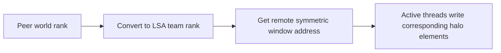

# Chapter 09: Complete LSA boundary writes in the NCCL Device API

[English](nccl-device.en.md) | [简体中文](nccl-device.md) | [日本語](nccl-device.ja.md)

Record date: 2026-11-15 (America/Chicago). For reviewing and reproducing the experiments after the course. English translation: 2026-11-16.

[Return to the day's experiment index](../../../docs/experiments/2026-11-15/README.en.md) · [Read the missing information and screenshot checklist](../../../docs/experiments/2026-11-15/MISSING_INFORMATION.en.md)

## Findings and scope

The day's implementation completes remote writes through the load/store-accessible (LSA) path and consistent path selection on host and device. The corrected 4 GPU log prints the program summary after numerical checks, with a solve time of 0.4340 s.

Archived notes describe numerical-check failures on the first valid row of each rank in an early implementation. The complete terminal log from that initial failure was not found. This report therefore treats it as a contemporary debugging record, separate from preserved corrected logs. This completes a course exercise implementation; it does not establish a defect in the NCCL library.

## Cause in the source and changes made

The original fork's exercise file left the LSA branch unfinished, and path selection returned false by default. The day's code handles an LSA-accessible peer in this order:

The diagram describes address conversion and writes in the source, not measured GPU scheduling time. See [path selection](archive/tasks/results/nccl-device-lsa-fix_20261115T223202Z/source/jacobi_kernels.cu#L130), [LSA remote writes](archive/tasks/results/nccl-device-lsa-fix_20261115T223202Z/source/jacobi_kernels.cu#L159), and [host-side selection](archive/tasks/results/nccl-device-lsa-fix_20261115T223202Z/source/jacobi_kernels.cu#L263).

## Results after correction

| Configuration | nccheck | 1 GPU / s | 4 GPU / s | Program-printed efficiency / % |
|---|---:|---:|---:|---:|
| LSA fix | 1 | 1.4703 | 0.4340 | 84.70 |

The original [benchmark.log](archive/tasks/results/nccl-device-lsa-fix_20261115T223202Z/logs/benchmark.log) corresponds to job 2925699, node jpbo-001-09, a 16384×16384 grid, 1000 iterations, and `nccheck=1`. The table reports program-printed rank 0 solve time. There is only one formal measurement, so it is not used to rank implementations from other jobs.

A separate group of 4-rank traces uses 10 iterations and `nccheck=10`. It is preserved separately from the table's 1000-iteration benchmark.

## Existing timeline observations and missing screenshots

The contemporary [experiment notes](archive/tasks/results/nccl-device-lsa-fix_20261115T223202Z/README.md) record a rank 0 host solve range of about 3.642 ms and a GPU projection range of about 3.627 ms. They report no separate halo PtoP memcpy. These are archived observations; this review did not independently remeasure them with Nsight.

This observation is consistent with remote stores inside the kernel, but does not alone prove that communication is fully hidden. Screenshots with time scales, kernel names, stream identifiers, and NVTX ranges are needed, along with logs or screenshots of the initial failure.
