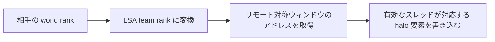

# 第 09 章：NCCL Device API の LSA 境界書き込みを補完する

[English](nccl-device.en.md) | [简体中文](nccl-device.md) | [日本語](nccl-device.ja.md)

記録日：2026-11-15（America/Chicago）。翻訳日：2026-11-16。講習後の復習と実験の再現に使う資料です。

[当日の実験索引に戻る](../../../docs/experiments/2026-11-15/README.ja.md) · [不足情報とスクリーンショットの一覧を見る](../../../docs/experiments/2026-11-15/MISSING_INFORMATION.ja.md)

## 結論と範囲

当日の実装では、load/store-accessible（LSA、直接ロード・ストア可能）経路のリモート書き込みと、ホスト側・デバイス側で一貫した経路選択を補完しました。修正後の 4 GPU ログは、数値検査後のプログラム集計出力を含み、ソルバー実行時間は 0.4340 s です。

保存した説明には、初期実装で各 rank の最初の有効行の数値検査に失敗したとの記録があります。ただし、初回失敗の完全な端末ログは見つかっていません。このため、当時のデバッグ記録として、保存済みの修正後ログとは分けて説明します。これは講習演習の実装を完成させる修正であり、NCCL ライブラリの欠陥とは判断できません。

## ソースコード上の原因と変更

元の fork の演習ファイルでは、LSA 分岐が未実装で、経路選択も既定で false を返していました。当日のコードは、LSA でアクセスできる peer を次の順で処理します。

図はソースコード上のアドレス変換と書き込みの流れを示し、GPU スケジューリング時間の実測値ではありません。ソースコードは [経路選択](archive/tasks/results/nccl-device-lsa-fix_20261115T223202Z/source/jacobi_kernels.cu#L130)、[LSA リモート書き込み](archive/tasks/results/nccl-device-lsa-fix_20261115T223202Z/source/jacobi_kernels.cu#L159)、[ホスト側の選択](archive/tasks/results/nccl-device-lsa-fix_20261115T223202Z/source/jacobi_kernels.cu#L263) を参照してください。

## 修正後の実験結果

| 構成 | nccheck | 1 GPU / s | 4 GPU / s | プログラムの表示効率 / % |
|---|---:|---:|---:|---:|
| LSA fix | 1 | 1.4703 | 0.4340 | 84.70 |

元の [benchmark.log](archive/tasks/results/nccl-device-lsa-fix_20261115T223202Z/logs/benchmark.log) は、ジョブ 2925699、ノード jpbo-001-09、16384×16384 格子、1000 回反復、`nccheck=1` に対応します。表はプログラムが表示した rank 0 のソルバー実行時間です。正式測定は 1 回だけで、他のジョブで測定した実装との順位付けには使いません。

別途、10 回反復、`nccheck=10` の 4-rank trace を 1 組保存しています。この trace は、表の 1000 回反復の benchmark と分けて保存しています。

## 既存のタイムライン観測と追加が必要なスクリーンショット

当時の [実験説明](archive/tasks/results/nccl-device-lsa-fix_20261115T223202Z/README.md) には、rank 0 のホスト側のソルバー実行範囲が約 3.642 ms、GPU 投影範囲が約 3.627 ms で、独立した halo PtoP memcpy は見られなかったと記録されています。これらは保存資料内の観測であり、今回の整理では Nsight ツールによる独立した再測定はしていません。

この現象は kernel 内のリモート store の実装と整合しますが、これだけで通信が完全に隠蔽されたとは証明できません。時間目盛り、kernel 名、ストリーム番号、NVTX 範囲を含むスクリーンショットと、初回失敗のログかスクリーンショットが必要です。
