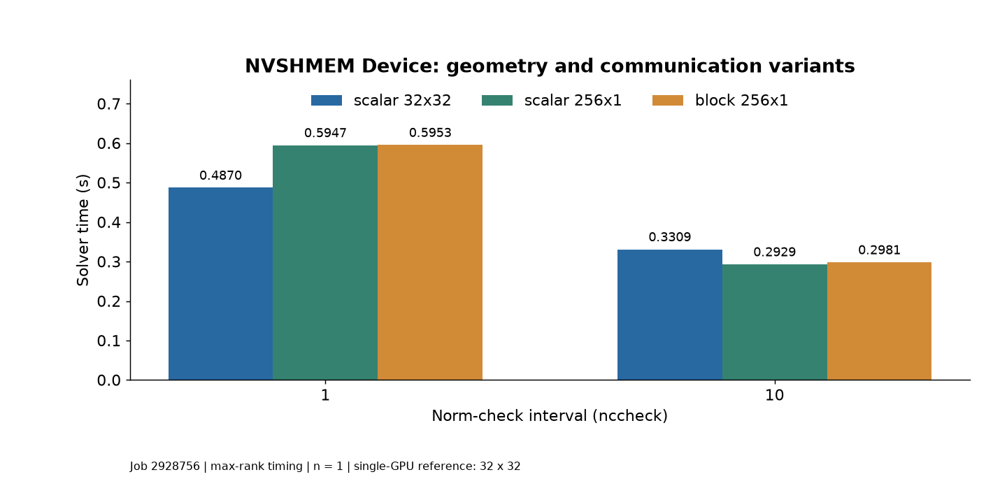

# Chapter 09: Three NVSHMEM Device API communication configurations

[English](nvshmem-device.en.md) | [简体中文](nvshmem-device.md) | [日本語](nvshmem-device.ja.md)

Record date: 2026-11-15 (America/Chicago). For reviewing and reproducing the experiments after the course. English translation: 2026-11-16.

[Return to the day's experiment index](../../../docs/experiments/2026-11-15/README.en.md) · [Read the missing information and screenshot checklist](../../../docs/experiments/2026-11-15/MISSING_INFORMATION.en.md)

## Findings and limits

Successful run records are preserved for scalar 32×32, scalar 256×1, and cooperative block 256×1 implementations. Each has two small-grid smoke tests, two formal benchmarks, and one short trace, totaling 15 run records. All six smoke tests are marked PASS.

At `nccheck=10`, scalar 256×1 has a maximum-rank four-GPU solve time of 0.292928 s, the lowest in this group. The program prints 105.64% efficiency. However, the single-GPU reference still uses 32×32 thread blocks. This value therefore does not establish strong scaling with matching kernel configurations.

## What differs among the configurations

- **Scalar 32×32:** Boundary threads call scalar puts individually. The GPU kernel writes directly to neighboring PEs. See [scalar writes](archive/tasks/Device-initiated_Communication_with_NVSHMEM/jacobi.cu#L155).
- **Scalar 256×1:** Scalar communication is retained with single-row thread blocks, providing a shape-matched comparison for block puts. See the [two one-dimensional launches](archive/tasks/Device-initiated_Communication_with_NVSHMEM/jacobi.cu#L368).
- **Cooperative block 256×1:** The whole thread block jointly performs a nonblocking put. All threads still participate in a partial tail block, while the valid transfer length is limited. See [block put](archive/tasks/Device-initiated_Communication_with_NVSHMEM/jacobi.cu#L165).

Each iteration runs an [NVSHMEM barrier](archive/tasks/Device-initiated_Communication_with_NVSHMEM/jacobi.cu#L383) in the same stream to ensure boundaries arrive before the next iteration reads them. Timing starts and ends with synchronization. Afterward, `MPI_MAX` collects the maximum rank time. See [timing and validation](archive/tasks/Device-initiated_Communication_with_NVSHMEM/jacobi.cu#L407).

## Results within one job

Job 2928756 used node jpbo-101-01, 4 GH200 GPUs, and NVSHMEM 3.8.0. Formal runs used a 16384×16384 grid, 1000 iterations, and sockets CPU binding. The table preserves maximum rank times to six decimal places from the logs. Single-GPU times and efficiencies remain the program-printed values.

| Configuration | nccheck | 1 GPU / s | 4 GPU / s | Program-printed efficiency / % |
|---|---:|---:|---:|---:|
| scalar 32x32 | 1 | 1.6856 | 0.487018 | 86.53 |
| scalar 32x32 | 10 | 1.2375 | 0.330935 | 93.48 |
| scalar 256x1 | 1 | 1.6816 | 0.594659 | 70.70 |
| scalar 256x1 | 10 | 1.2378 | 0.292928 | 105.64 |
| block 256x1 | 1 | 1.6861 | 0.595289 | 70.81 |
| block 256x1 | 10 | 1.2348 | 0.298059 | 103.57 |

Scalar 256×1 and block 256×1 share a thread-block shape, but each still has only one observation per setting. Current results do not support a claim that block put is always faster. Differences between 32×32 and 256×1 also involve thread layout, so they cannot be attributed entirely to communication granularity.

## Correctness and baseline checks

Each configuration ran on a 261×259 grid with `nccheck=3`, for 3 and 4 iterations respectively. These cover tail thread blocks, odd/even buffers, and a final iteration without a norm check. Logs are marked PASS. The source compares local valid rows element by element and rejects non-finite values. This remains a limited test set, not proof of correctness for every size and process count.

The single-GPU reference [thread-block definition](archive/tasks/Device-initiated_Communication_with_NVSHMEM/jacobi.cu#L551) is fixed at 32×32. Future work should add a matching 256×1 reference configuration or compare 1 PE and 4 PE using the same NVSHMEM implementation. These baselines answer different questions and should be reported separately.

## Source, run scripts, and missing screenshots

The three timestamped result directories each preserve `source/`, environment information, full commands, exit codes, and short traces. Each trace group contains 4 ranks. See [profiles.csv](../../../docs/experiments/2026-11-15/data/profiles.csv) for paths and [run_experiment_v3.sh](archive/tasks/Device-initiated_Communication_with_NVSHMEM/run_experiment_v3.sh) for the final script.

Kernel and barrier screenshots for matching iteration windows across all three configurations are still needed. Screenshots can locate follow-up questions. They cannot resolve the inconsistent baseline behind 105.64% until the single-GPU reference is matched and measurements are repeated.
