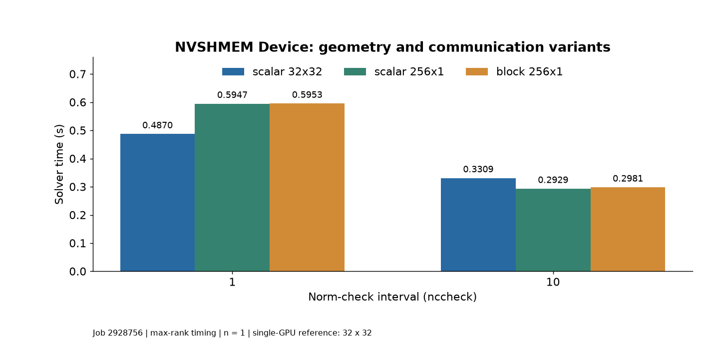

# 第 09 章：NVSHMEM Device API の 3 種類の通信構成

[English](nvshmem-device.en.md) | [简体中文](nvshmem-device.md) | [日本語](nvshmem-device.ja.md)

記録日：2026-11-15（America/Chicago）。翻訳日：2026-11-16。講習後の復習と実験の再現に使う資料です。

[当日の実験索引に戻る](../../../docs/experiments/2026-11-15/README.ja.md) · [不足情報とスクリーンショットの一覧を見る](../../../docs/experiments/2026-11-15/MISSING_INFORMATION.ja.md)

## 追加研究 — 2026-11-16

本ページは 11 月 15 日の証拠を記述しています。[11 月 16 日の研究記録](../../../research/2026-11-16/README.ja.md)と[知見・状態の照合](../../../research/2026-11-16/FINDINGS.ja.md)に、修正後の厳密検証と基準形状をそろえた測定があります。1 行の部分領域と同じ実装の 1 PE/4 PE 強スケーリングが未測定のため、Q1/Q4 は一部完了です。以下の過去のソース、時間、trace は変更していません。

## 結論と制約

スカラー 32×32、スカラー 256×1、協調ブロック 256×1 の 3 実装すべてに、成功した実行記録があります。各実装には、小格子の smoke test 2 回、正式 benchmark 2 回、短い trace 1 回があり、合計 15 件の実行記録です。smoke test 6 回はすべて PASS と記録されています。

`nccheck=10` では、スカラー 256×1 の 4 GPU の最大 rank ソルバー実行時間が 0.292928 s で、この組で最小でした。プログラムの表示効率は 105.64% ですが、単一 GPU の基準は引き続き 32×32 スレッドブロックを使っています。そのため、この値は同じ kernel 構成での強スケーリングの結論には使えません。

## 3 構成の違い

- **スカラー 32×32：** 境界スレッドが個別にスカラー put を呼び、GPU kernel から隣接する処理要素（PE）に直接書き込みます。[スカラー書き込み](archive/tasks/Device-initiated_Communication_with_NVSHMEM/jacobi.cu#L155) を参照してください。
- **スカラー 256×1：** スカラー通信を維持し、1 行のスレッドブロックに変えます。block put と同じ形状の比較構成です。[2 種類の 1 次元起動](archive/tasks/Device-initiated_Communication_with_NVSHMEM/jacobi.cu#L368) を参照してください。
- **協調ブロック 256×1：** スレッドブロック全体が協調してノンブロッキング put を実行します。末尾がブロックを満たさない場合も全スレッドが参加し、有効な転送長を制限します。[block put](archive/tasks/Device-initiated_Communication_with_NVSHMEM/jacobi.cu#L165) を参照してください。

各反復は同じストリームで [NVSHMEM barrier](archive/tasks/Device-initiated_Communication_with_NVSHMEM/jacobi.cu#L383) を実行し、次の反復で読み取る前に境界データの受信を保証します。計時の前後で同期し、終了後に `MPI_MAX` で各 rank の時間を集約します。[計時と検証](archive/tasks/Device-initiated_Communication_with_NVSHMEM/jacobi.cu#L407) を参照してください。

## 同一ジョブ内の結果

ジョブ 2928756、ノード jpbo-101-01、GH200 を 4 GPU、NVSHMEM 3.8.0 で実行しました。正式測定の格子は 16384×16384、1000 回反復、CPU バインドは sockets です。表はログの最大 rank 時間を小数点以下 6 桁のまま残しています。単一 GPU 時間と効率は、引き続きプログラムの表示値を使っています。

| 構成 | nccheck | 1 GPU / s | 4 GPU / s | プログラムの表示効率 / % |
|---|---:|---:|---:|---:|
| scalar 32x32 | 1 | 1.6856 | 0.487018 | 86.53 |
| scalar 32x32 | 10 | 1.2375 | 0.330935 | 93.48 |
| scalar 256x1 | 1 | 1.6816 | 0.594659 | 70.70 |
| scalar 256x1 | 10 | 1.2378 | 0.292928 | 105.64 |
| block 256x1 | 1 | 1.6861 | 0.595289 | 70.81 |
| block 256x1 | 10 | 1.2348 | 0.298059 | 103.57 |

スカラー 256×1 と block 256×1 は同じスレッドブロック形状ですが、各 1 回の観測しかありません。現結果は「block put は常に速い」という主張を裏付けません。32×32 と 256×1 の差にはスレッド配置の違いもあるため、すべてを通信粒度に帰すことはできません。

## 正しさと基準の確認

各構成を 261×259 格子、`nccheck=3` で、3 回反復と 4 回反復をそれぞれ実行しました。末尾のスレッドブロック、奇数・偶数のバッファ、最終反復でノルム確認をしない場合を含みます。ログは PASS と記録されています。ソースコードはローカルの有効行を要素ごとに比較し、非有限値を拒否します。それでも有限のテスト集合であり、すべてのサイズとプロセス数に対する正しさの証明ではありません。

単一 GPU 基準の [スレッドブロック定義](archive/tasks/Device-initiated_Communication_with_NVSHMEM/jacobi.cu#L551) は 32×32 に固定されています。今後は基準ソルバーに対応する 256×1 構成を追加するか、同じ NVSHMEM 実装で 1 PE と 4 PE を比較する必要があります。この 2 種類の基準は異なる問いに答えるため、別々に報告してください。

## ソースコード、実行スクリプト、追加が必要なスクリーンショット

タイムスタンプ付きの結果ディレクトリ 3 組には、それぞれ `source/`、環境、完全なコマンド、終了コード、短い trace を保存しています。各組の trace は 4 rank 分です。パスは [profiles.csv](../../../docs/experiments/2026-11-15/data/profiles.csv)、最終スクリプトは [run_experiment_v3.sh](archive/tasks/Device-initiated_Communication_with_NVSHMEM/run_experiment_v3.sh) を参照してください。

3 構成の同じ反復区間を示す kernel と barrier のスクリーンショットが、まだ必要です。スクリーンショットは今後の問題調査に役立ちます。ただし、単一 GPU 基準をそろえて反復測定を増やすまでは、105.64% という値の基準の不一致は解消できません。
