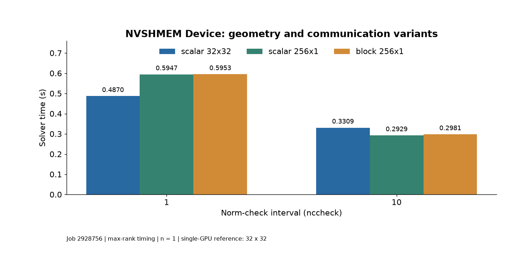

# 第 09 章：NVSHMEM Device API 的三种通信配置

[English](nvshmem-device.en.md) | [简体中文](nvshmem-device.md) | [日本語](nvshmem-device.ja.md)

记录日期：2026-11-15（America/Chicago）。供课后复习与复现实验使用。

[返回当天实验索引](../../../docs/experiments/2026-11-15/README.md) · [查看待补信息与截图清单](../../../docs/experiments/2026-11-15/MISSING_INFORMATION.md)

## 后续研究 — 2026-11-16

本页描述 11 月 15 日的证据。[11 月 16 日研究日志](../../../research/2026-11-16/README.md)及[发现/状态对照](../../../research/2026-11-16/FINDINGS.md)补充了严格验证与匹配参考测量。Q1、Q4 仍为部分完成：单行子域与同实现 1 PE/4 PE 强扩展尚未测试。下方历史源码快照、耗时与 trace 保持原样。

## 结论与限制

标量 32×32、标量 256×1、协作块 256×1 三种实现均保存了成功运行记录。每种实现有两次小网格 smoke test、两次正式 benchmark 和一次短 trace，共 15 个运行记录。六次 smoke test 均记为 PASS。

`nccheck=10` 时，标量 256×1 的四 GPU 最大 rank 求解时间为 0.292928 s，是本组最低值。程序打印效率为 105.64%，但单 GPU 参考仍使用 32×32 线程块，因此不能把这个数字作为同一 kernel 配置的强扩展结论。

## 三种配置改变了什么

- **标量 32×32：** 边界线程分别调用标量 put，由 GPU kernel 直接写入相邻 PE。见 [标量写入](archive/tasks/Device-initiated_Communication_with_NVSHMEM/jacobi.cu#L155)。
- **标量 256×1：** 保持标量通信，改用一行线程块，作为与 block put 相同形状的对照。见 [两种一维启动](archive/tasks/Device-initiated_Communication_with_NVSHMEM/jacobi.cu#L368)。
- **协作块 256×1：** 由整个线程块共同执行非阻塞 put。尾部不满块时仍让全部线程参与，并限制有效传输长度。见 [block put](archive/tasks/Device-initiated_Communication_with_NVSHMEM/jacobi.cu#L165)。

每轮在同一流中执行 [NVSHMEM barrier](archive/tasks/Device-initiated_Communication_with_NVSHMEM/jacobi.cu#L383)，保证下一轮读取前收到边界。计时前后同步，并在结束后以 `MPI_MAX` 汇总各 rank 时间，见 [计时与验证](archive/tasks/Device-initiated_Communication_with_NVSHMEM/jacobi.cu#L407)。

## 同一作业中的结果

作业 2928756，节点 jpbo-101-01，4 张 GH200，NVSHMEM 3.8.0。正式网格为 16384×16384，1000 次迭代，CPU 绑定 sockets。下表保留日志中的六位小数最大 rank 时间；单 GPU 时间和效率仍采用程序的打印值。

| 配置 | nccheck | 1 GPU / s | 4 GPU / s | 程序打印效率 / % |
|---|---:|---:|---:|---:|
| scalar 32x32 | 1 | 1.6856 | 0.487018 | 86.53 |
| scalar 32x32 | 10 | 1.2375 | 0.330935 | 93.48 |
| scalar 256x1 | 1 | 1.6816 | 0.594659 | 70.70 |
| scalar 256x1 | 10 | 1.2378 | 0.292928 | 105.64 |
| block 256x1 | 1 | 1.6861 | 0.595289 | 70.81 |
| block 256x1 | 10 | 1.2348 | 0.298059 | 103.57 |

标量 256×1 与 block 256×1 的线程块形状相同，但也只有各一次观测。现有结果不支持“block put 总是更快”的说法。32×32 与 256×1 的差异同时涉及线程布局，不能全部归因于通信粒度。

## 正确性与基准检查

每种配置都用 261×259 网格、`nccheck=3`，分别运行 3 次和 4 次迭代，覆盖尾部线程块、奇偶缓冲和末轮不检查范数的情况。日志记为 PASS；源码逐项比较本地有效行，并拒绝非有限值。它仍是有限测试集，不是所有尺寸和进程数的正确性证明。

单 GPU 参考的 [线程块定义](archive/tasks/Device-initiated_Communication_with_NVSHMEM/jacobi.cu#L551) 固定为 32×32。后续应为参考求解器增加匹配的 256×1 配置，或另用相同 NVSHMEM 实现比较 1 PE 与 4 PE。两种基准回答不同问题，应分别报告。

## 源码、运行脚本与待补截图

三组带时间戳的结果目录分别保存 `source/`、环境、完整命令、退出码及短 trace，每组 trace 有 4 个 rank。路径见 [profiles.csv](../../../docs/experiments/2026-11-15/data/profiles.csv)；最终脚本见 [run_experiment_v3.sh](archive/tasks/Device-initiated_Communication_with_NVSHMEM/run_experiment_v3.sh)。

还需三种配置相同迭代窗口的 kernel 与 barrier 截图。截图可以定位后续问题，但在匹配单 GPU 参考和增加重复测量之前，不能消除 105.64% 基准不一致的问题。
