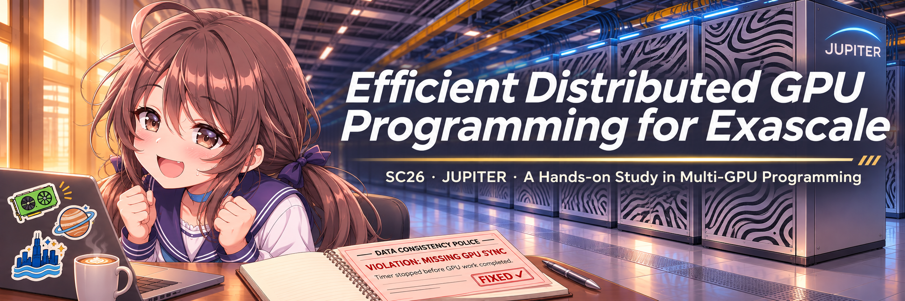

# SC26 チュートリアル：エクサスケールに向けた効率的な分散 GPU プログラミング

[English](README.md) | [简体中文](README.zh-CN.md) | [日本語](README.ja.md)

このリポジトリには、[SC26 の分散 GPU プログラミングチュートリアル](https://sc26.conference-program.com/presentation/?id=tut120&sess=sess190)の講義資料と演習を保存しています。受講中の学習と受講後の復習に使えます。開催日は 2026-11-15、実験報告の三言語版を整理した日は 2026-11-16 です。

## 研究 checkpoint — 2026-11-16

本日の追加研究では Chapter04 の最終行・非有限値修正を正例 12 件と負例 3 件で確認し、NVSHMEM の基準形状を主測定 64 件と追加反復 9 件で調べました。`nccheck=10` では形状をそろえると表示効率の中央値が 105.5985% から 92.8498% に下がります。1 行の部分領域と同じ実装の 1 PE/4 PE 強スケーリングは未検証です。

- [研究記録と根拠の索引](research/2026-11-16/README.ja.md)
- [研究の知見、統計分析、過去の課題の進捗](research/2026-11-16/FINDINGS.ja.md)
- [更新した研究課題](docs/experiments/2026-11-15/OPEN_QUESTIONS.ja.md)と[不足情報の一覧](docs/experiments/2026-11-15/MISSING_INFORMATION.ja.md)

範囲の広い元の課題二つは一部完了です。元の証拠を保持し、今回の文書照合で GPU 実験を再実行していません。

## 2026-11-15 の実験記録

この fork には、当日完成したソースコードのスナップショット、実験ログ、英語・中国語・日本語の報告書を保存しています。元の演習は元の場所に残し、完成版と実験資料は各章の `reports/2026-11-15/archive/` に置いています。報告書では、観測結果、失敗した実行、今後の検証課題を区別しています。

- [第 04 章：MPI 通信と計算の重なり、および計時の修正](04-H_Overlap_Communication_and_Computation_MPI/reports/2026-11-15/README.ja.md)
- [第 07 章：NCCL Host API](07-H_NCCL_NVSHMEM/reports/2026-11-15/nccl-host.ja.md)
- [第 07 章：NVSHMEM Host と実行時間の異常の再確認](07-H_NCCL_NVSHMEM/reports/2026-11-15/nvshmem-host.ja.md)
- [第 09 章：NCCL Device の LSA 書き込み](09-H_Device-initiated_Communication_and_CUDA_Graphs/reports/2026-11-15/nccl-device.ja.md)
- [第 09 章：CUDA Graph のノード優先度](09-H_Device-initiated_Communication_and_CUDA_Graphs/reports/2026-11-15/cuda-graphs.ja.md)
- [第 09 章：NVSHMEM Device の三つの構成](09-H_Device-initiated_Communication_and_CUDA_Graphs/reports/2026-11-15/nvshmem-device.ja.md)

まず[環境、計時方法、実験資料の索引](docs/experiments/2026-11-15/README.ja.md)を参照してください。[不足している情報とスクリーンショット](docs/experiments/2026-11-15/MISSING_INFORMATION.ja.md)、[今後の研究課題](docs/experiments/2026-11-15/OPEN_QUESTIONS.ja.md)もまとめています。56 件の Nsight レポートは元のバイト列を保っています。文書の整理中に GPU クラスタで実験を再実行したわけではありません。

## 開催情報

- **開催日：** 2026 年 11 月 15 日。
- **会場の企画：** SC26 の終日チュートリアル。
- **講師：** Simon Garcia de Gonzalo（SNL）、Oded Green（NVIDIA）、Andreas Herten（JSC）、Lena Oden（Uni Hagen）。
- **サポート：** David Appelhans（NVIDIA）、Markus Hrywniak（NVIDIA）、Jiri Kraus（NVIDIA）。

## 受講環境と講義・演習の流れ

このチュートリアルでは、導入講義の内容を動かしながら学びます。演習は [NVIDIA/multi-gpu-programming-models](https://github.com/NVIDIA/multi-gpu-programming-models) にある Jacobi ソルバーの実装を基にしています。

以下は当日の受講環境を設定する手順です。SC26 の現地チュートリアル環境でのみ利用できます。

1. JuDoor に登録します。
2. [Jupyter JSC](https://jupyter.jsc.fz-juelich.de) を開きます。
3. training26XX アカウントを使い、**LoginNode** 上で [JUPITER の Jupyter インスタンス](https://jupyter.jsc.fz-juelich.de/workshops/sc26mg)を作成します。[^1]
4. `source $PROJECT_training26XX/env.sh` で受講環境を読み込みます。
5. `jsc-material-sync` で資料を同期します。
6. 手元のコンピュータに [NVIDIA Nsight Systems](https://developer.nvidia.com/nsight-systems) をインストールします。

講義・演習の順序：

1. 講義：チュートリアルの概要、システム紹介、受講準備。担当：Andreas。
2. 講義：GPU を使う MPI 分散計算の入門。担当：Simon。
3. 講義：マルチ GPU アプリケーションの最適化。担当：Simon。
4. 演習：MPI 通信と計算を重ねて実行する。
5. 講義：性能分析・デバッグツール。
6. 講義：MPI プログラムで使う NCCL と NVSHMEM の概要。担当：Lena。
7. 演習：NCCL と NVSHMEM を使う。
8. 講義：CUDA Graph と、NCCL・NVSHMEM を使うデバイス側からの通信。担当：Oded。
9. 演習：NVSHMEM と NCCL を使うデバイス側からの通信。
10. 講義：まとめと発展的な話題の紹介。担当：Andreas。

## 謝辞

本プロジェクトは、シカゴの SC26 で開催された **Efficient Distributed GPU Programming for Exascale** チュートリアルを基にしています。このチュートリアルには、Jülich Supercomputing Centre、NVIDIA、Sandia National Laboratories、University of Hagen に所属する研究者が貢献しています。

JUPITER スーパーコンピュータで実験を行う機会を提供してくださったチュートリアルの講師の皆さまと Jülich Supercomputing Centre に、心より感謝します。

[^1]: 通常は JUPITER を使います。講師から予備の JUWELS Booster に切り替えるよう案内があった場合は、[JUWELS Booster の Jupyter インスタンス](https://jupyter.jsc.fz-juelich.de/workshops/sc26mg-juwels)を作成してください。
