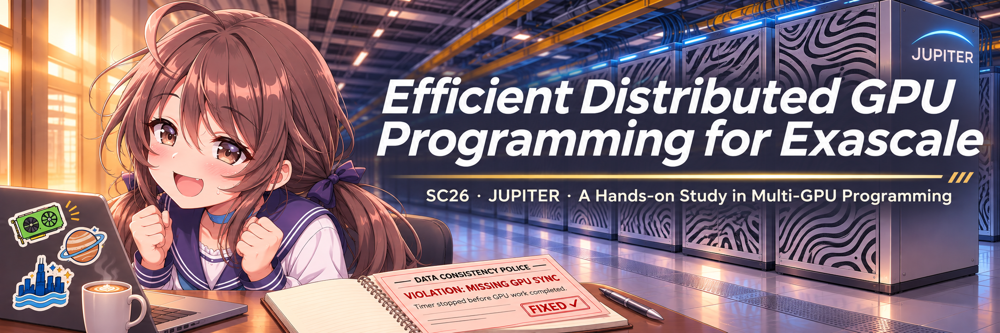

# SC26 教程：面向 Exascale 的高效分布式 GPU 编程

[English](README.md) | [简体中文](README.zh-CN.md) | [日本語](README.ja.md)

本仓库保存 [SC26 高效分布式 GPU 编程教程](https://sc26.conference-program.com/presentation/?id=tut120&sess=sess190) 的讲义和练习，供课程学习和课后复习使用。课程日期为 2026-11-15；实验报告三语整理日期为 2026-11-16。

## 研究检查点 — 2026-11-16

今天的后续研究验证了 Chapter04 末行/非有限值修正（12 项正向测试、3 项负向对照），并用 64 项主测量和 9 项额外重复检验 NVSHMEM 参考几何。`nccheck=10` 时，匹配参考几何使报告效率中位数从 105.5985% 降至 92.8498%。单行子域和同实现 1 PE/4 PE 强扩展仍待验证。

- [研究日志与证据索引](research/2026-11-16/README.md)
- [研究发现、统计分析与既有问题完成情况](research/2026-11-16/FINDINGS.md)
- [更新后的研究问题](docs/experiments/2026-11-15/OPEN_QUESTIONS.md)与[缺失信息清单](docs/experiments/2026-11-15/MISSING_INFORMATION.md)

两个范围较广的原始研究问题均为部分完成。原始证据保留；本次文档核对没有重新运行 GPU 实验。

## 当天实验记录（2026-11-15）

本 fork 保存了当天完成的代码快照、实验日志和英中日三语报告。原课程练习保留在原位置，完成版本及结果位于各章 `reports/2026-11-15/archive/`。报告区分已有观测、失败记录和待验证问题。

- [第 04 章：MPI 重叠与计时修正](04-H_Overlap_Communication_and_Computation_MPI/reports/2026-11-15/README.md)
- [第 07 章：NCCL Host API](07-H_NCCL_NVSHMEM/reports/2026-11-15/nccl-host.md)
- [第 07 章：NVSHMEM Host 与异常复查](07-H_NCCL_NVSHMEM/reports/2026-11-15/nvshmem-host.md)
- [第 09 章：NCCL Device LSA 写入](09-H_Device-initiated_Communication_and_CUDA_Graphs/reports/2026-11-15/nccl-device.md)
- [第 09 章：CUDA Graph 节点优先级](09-H_Device-initiated_Communication_and_CUDA_Graphs/reports/2026-11-15/cuda-graphs.md)
- [第 09 章：NVSHMEM Device 三种配置](09-H_Device-initiated_Communication_and_CUDA_Graphs/reports/2026-11-15/nvshmem-device.md)

统一入口：[环境、计时口径与原始资料索引](docs/experiments/2026-11-15/README.md)。另见 [待补信息与截图](docs/experiments/2026-11-15/MISSING_INFORMATION.md)、[后续研究问题](docs/experiments/2026-11-15/OPEN_QUESTIONS.md)。56 份 Nsight 报告按原字节保存；文档整理期间没有在集群重跑 GPU 实验。

## 课程信息

- **日期：** 2026 年 11 月 15 日。
- **活动：** SC26 全天教程。
- **讲师：** Simon Garcia de Gonzalo（SNL）、Oded Green（NVIDIA）、Andreas Herten（JSC）、Lena Oden（Uni Hagen）。
- **支持人员：** David Appelhans（NVIDIA）、Markus Hrywniak（NVIDIA）、Jiri Kraus（NVIDIA）。

## 课程环境与安排

本教程结合概念讲解和动手练习。练习源自 [NVIDIA/multi-gpu-programming-models](https://github.com/NVIDIA/multi-gpu-programming-models) 中的 Jacobi 求解器实现。

以下是原课程的现场设置步骤，仅适用于 SC26 现场课程环境：

1. 注册 JuDoor。
2. 打开 [Jupyter JSC](https://jupyter.jsc.fz-juelich.de)。
3. 使用 training26XX 账户，在 **LoginNode** 上创建 [JUPITER Jupyter 实例](https://jupyter.jsc.fz-juelich.de/workshops/sc26mg)。[^1]
4. 加载课程环境：`source $PROJECT_training26XX/env.sh`。
5. 同步材料：`jsc-material-sync`。
6. 在本机安装 [NVIDIA Nsight Systems](https://developer.nvidia.com/nsight-systems)。

课程安排：

1. 讲授：教程概览、系统介绍与入门。讲师：Andreas。
2. 讲授：使用 GPU 的 MPI 分布式计算入门。讲师：Simon。
3. 讲授：多 GPU 应用的优化方法。讲师：Simon。
4. 练习：重叠 MPI 通信与计算。
5. 讲授：性能分析与调试工具。
6. 讲授：MPI 程序中的 NCCL 与 NVSHMEM 概览。讲师：Lena。
7. 练习：使用 NCCL 与 NVSHMEM。
8. 讲授：CUDA Graph 及使用 NCCL、NVSHMEM 的设备发起通信。讲师：Oded。
9. 练习：使用 NVSHMEM 和 NCCL 的设备发起通信。
10. 讲授：总结与进阶主题概览。讲师：Andreas。

## 致谢

本项目基于在芝加哥 SC26 会议上讲授的 **Efficient Distributed GPU Programming for Exascale** 教程。该教程凝聚了来自 Jülich Supercomputing Centre、NVIDIA、Sandia National Laboratories 和 University of Hagen 的研究人员的贡献。

特别感谢教程讲师和 Jülich Supercomputing Centre，让我们有机会在 JUPITER 超级计算机上开展实验。

[^1]: 默认使用 JUPITER。如果讲师要求切换到备用的 JUWELS Booster，请创建 [JUWELS Booster Jupyter 实例](https://jupyter.jsc.fz-juelich.de/workshops/sc26mg-juwels)。
