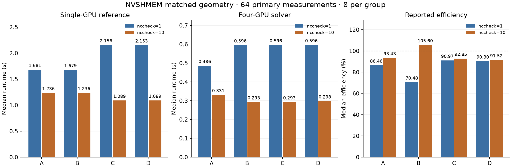

# SC26 GPU research log — 2026-11-16

[English](README.en.md) | [简体中文](README.md) | [日本語](README.ja.md)

Review strict MPI numerical validation, the NVSHMEM reference-geometry comparison, and progress against earlier questions.

Date: 2026-11-16. Audience: researchers reviewing or reproducing these experiments.

## Overview

Chapter04 fixes omitted last-row and non-finite checks: 12 positive tests pass and three injected errors are rejected. Chapter09A preserves 64 primary measurements and nine extra valid repetitions. At `nccheck=10`, matching reference geometry reduces median efficiency from 105.5985% to 92.8498%, with almost unchanged four-GPU runtime.

Two core subquestions are answered; both original research questions remain partially addressed. Single-row subdomains and same-implementation NVSHMEM 1 PE/4 PE strong scaling remain untested. Graph-priority stability, the Host anomaly and missing old evidence remain open. This integration reviews existing cluster logs; it does not rerun GPU experiments.

## Find the log, findings and analysis

- [Findings, statistical analysis and question-by-question status](FINDINGS.en.md).
- [Author's original research log](RESEARCH_LOG.original.md), preserved byte for byte; subsequent status review is separate.
- [Chapter04 validation results](chapter04-mpi-validation/validation_results.csv).
- [Chapter09A primary dataset](chapter09a-nvshmem/summary/20261116T155724Z/benchmark_results.csv), [all valid data](chapter09a-nvshmem/summary/20261116T155724Z/all_valid_results.csv), [extra repetitions](chapter09a-nvshmem/summary/20261116T155724Z/extra_repeats.csv) and [rejected logs](chapter09a-nvshmem/summary/20261116T155724Z/rejected_logs.csv).
- [Medians and quartiles](analysis/primary_summary.csv), [within-allocation pairs](analysis/paired_geometry.csv) and [structured status](analysis/question_status.json).
- [Archive verification](VERIFICATION.md), [file provenance](evidence-map.csv), [archive identities](provenance.json) and [third-party notices](THIRD_PARTY_NOTICES.md).

## Reproduce the analysis

1. From this directory, run `shasum -a 256 -c SHA256SUMS`.
2. Enter `chapter09a-nvshmem/work` and run `python3 ../summarize_matched.py`. It creates a UTC-stamped directory whose six CSV tables should match the archived parsed rows.
3. With Matplotlib installed, run `python3 figures/plot_results.py` from this directory to regenerate the figure from 64 primary rows.
4. Run `python3 analysis/summarize_primary.py` to regenerate primary medians, inclusive quartiles and within-allocation paired changes using only Python’s standard library.

Source snapshots, patches and original build hashes remain in the chapter directories. GPU reruns require compatible CUDA, MPI, NVSHMEM and a four-GPU Slurm allocation. Adjust environment paths and rebuild in a separate copy. Original `build.sha256` files also list omitted historical executables; a new build need not have identical hashes. With complete old logs present, `resume_matched.py --run` launches no new cases. Use a separate copy and fresh logs for a new experiment.

## Publication boundary

Full ZIP/tar archives, executables, objects, caches, macOS metadata, build logs, allocation dumps and GPU inventories remain local. Selected original evidence and the author's log are unchanged; source licenses remain attached. Job IDs, node labels, process IDs and CPU binding distinguish experiments; see the [publication review](RELEASE_REVIEW.md).

This checkpoint contains only Chapter04 and Chapter09A. The previous day's 56 Nsight reports remain linked from the [earlier experiment index](../../docs/experiments/2026-11-15/README.en.md). Missing old output and trace screenshots were not supplied by this archive.
