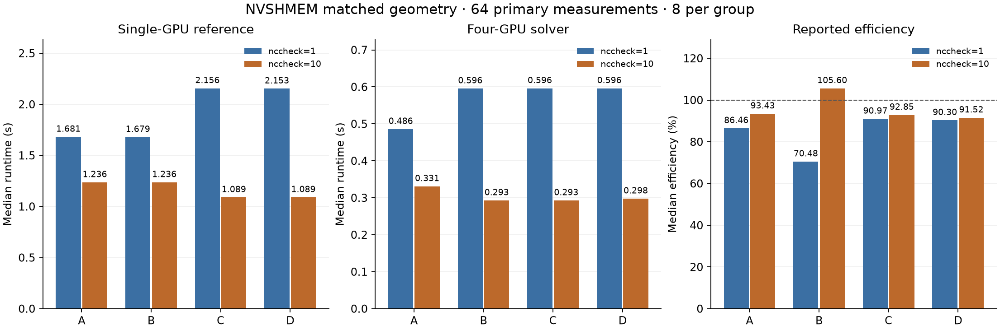

# SC26 GPU 研究記録 — 2026-11-16

[English](README.en.md) | [简体中文](README.md) | [日本語](README.ja.md)

MPI の厳密な数値検証、NVSHMEM の基準形状の比較、過去の課題への回答を確認する資料です。

日付：2026-11-16。読者：実験を検証・再現する研究者。

## 概要

Chapter04 では最終有効行の漏れと非有限値検査を修正し、正例 12 件が合格、注入した誤り 3 件が拒否されました。Chapter09A は主測定 64 件と有効な追加反復 9 件を保存しています。`nccheck=10` では基準形状をそろえると効率の中央値が 105.5985% から 92.8498% へ下がり、4 GPU の時間はほぼ同じでした。

二つの中心的な小課題には回答できましたが、元の研究課題二つは一部完了です。1 行の部分領域、同じ NVSHMEM 実装の 1 PE/4 PE 強スケーリングは未測定です。Graph 優先度の安定性、Host 異常、不足する過去の資料も未解決です。今回の統合では既存のクラスタログを確認し、GPU 実験を再実行していません。

## 研究記録、知見、分析を読む

- [知見、統計、課題ごとの照合](FINDINGS.ja.md)。
- [著者の元の研究記録（英語）](RESEARCH_LOG.original.md)：バイト列を変更せず保存し、その後の進捗確認と分けています。
- [Chapter04 の検証結果](chapter04-mpi-validation/validation_results.csv)。
- [Chapter09A の主データ](chapter09a-nvshmem/summary/20261116T155724Z/benchmark_results.csv)、[全有効データ](chapter09a-nvshmem/summary/20261116T155724Z/all_valid_results.csv)、[追加反復](chapter09a-nvshmem/summary/20261116T155724Z/extra_repeats.csv)、[除外ログ](chapter09a-nvshmem/summary/20261116T155724Z/rejected_logs.csv)。
- [中央値と四分位点](analysis/primary_summary.csv)、[同じ allocation 内の対応比較](analysis/paired_geometry.csv)、[構造化した状態](analysis/question_status.json)。
- [保存資料の検査（英語）](VERIFICATION.md)、[ファイルの出所](evidence-map.csv)、[アーカイブ識別情報](provenance.json)、[第三者ライセンス](THIRD_PARTY_NOTICES.md)。

## 分析を再現する

1. このディレクトリで `shasum -a 256 -c SHA256SUMS` を実行します。
2. `chapter09a-nvshmem/work` で `python3 ../summarize_matched.py` を実行します。新しい UTC 時刻付きディレクトリにできる CSV 6 表の解析済み行は、保存済みの表と一致するはずです。
3. Matplotlib を用意し、このディレクトリで `python3 figures/plot_results.py` を実行すると、主データ 64 件から図を再生成できます。
4. `python3 analysis/summarize_primary.py` を実行すると、Python 標準ライブラリだけで主標本の中央値、包含式四分位点、同 allocation 内の対応変化を再生成できます。

各章のディレクトリにはソース、パッチ、元のビルドハッシュがあります。GPU の再測定には対応する CUDA、MPI、NVSHMEM と 4 GPU の Slurm allocation が必要です。別のコピーで環境パスを調整して再ビルドしてください。元の `build.sha256` には公開対象外の過去の実行ファイルもあり、新ビルドの同一ハッシュを保証しません。完全な旧ログがあれば `resume_matched.py --run` は新たに実行しません。追加測定には別コピーと新しいログディレクトリを使ってください。

## 公開範囲

完全な ZIP/tar、実行ファイル、オブジェクト、キャッシュ、macOS メタデータ、ビルドログ、allocation ダンプ、GPU 一覧は手元に保存しています。選別した元の証拠と著者の記録は変更せず、ソース内のライセンス表示も保持しています。Job ID、ノード名、プロセス ID、CPU バインド情報は実験を識別するために残しています。[公開前の確認](RELEASE_REVIEW.md)を参照してください。

本 checkpoint は Chapter04 と Chapter09A のみです。前日の Nsight レポート 56 件は[過去の実験索引](../../docs/experiments/2026-11-15/README.ja.md)が示す場所にあります。不足する過去の出力や trace の画像は、この保存作業では補われていません。
