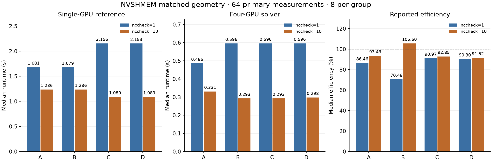

# SC26 GPU 研究日志 — 2026-11-16

[English](README.en.md) | [简体中文](README.md) | [日本語](README.ja.md)

查阅 MPI 严格数值验证、NVSHMEM 参考几何对照及其对既有问题的回答。

日期：2026-11-16。读者：复核或复现实验的研究者。

## 概览

Chapter04 修复了最后有效行遗漏与非有限值检查，12 项正向验证通过，3 项注入错误被拒绝。Chapter09A 保存了 64 项主测量和 9 项额外有效重复。`nccheck=10` 时，匹配参考几何使效率中位数从 105.5985% 降至 92.8498%，四 GPU 耗时基本不变。

两个核心子问题已有回答，但两个原始研究问题仍为部分完成。单行子域与同一 NVSHMEM 实现的 1 PE/4 PE 强扩展尚未测试。Graph 优先级稳定性、Host 异常和缺失旧资料仍待解决。本次合并核对已有集群日志，没有重新运行 GPU 实验。

## 研究日志、发现与分析入口

- [发现、统计分析与问题逐项对照](FINDINGS.md)。
- [用户原始研究日志（英文原文）](RESEARCH_LOG.original.md)：逐字节保留，后续状态核对单独记录。
- [Chapter04 验证结果](chapter04-mpi-validation/validation_results.csv)。
- [Chapter09A 主数据](chapter09a-nvshmem/summary/20261116T155724Z/benchmark_results.csv)、[全部有效数据](chapter09a-nvshmem/summary/20261116T155724Z/all_valid_results.csv)、[额外重复](chapter09a-nvshmem/summary/20261116T155724Z/extra_repeats.csv)及[排除日志](chapter09a-nvshmem/summary/20261116T155724Z/rejected_logs.csv)。
- [中位数与四分位数](analysis/primary_summary.csv)、[同 allocation 配对](analysis/paired_geometry.csv)及[结构化状态](analysis/question_status.json)。
- [英文归档核验](VERIFICATION.md)、[文件来源](evidence-map.csv)、[归档标识](provenance.json)与[第三方许可声明](THIRD_PARTY_NOTICES.md)。

## 复现分析

1. 在本目录执行 `shasum -a 256 -c SHA256SUMS`。
2. 进入 `chapter09a-nvshmem/work`，运行 `python3 ../summarize_matched.py`。新生成 UTC 时间戳目录中的 6 张 CSV 应与归档表的解析行一致。
3. 安装 Matplotlib 后，在本目录运行 `python3 figures/plot_results.py`，从 64 项主数据重新绘图。
4. 执行 `python3 analysis/summarize_primary.py`，仅用 Python 标准库重新生成主样本中位数、包含式四分位数及同 allocation 配对变化。

各章目录保留源码快照、补丁与原构建哈希。GPU 重跑需要兼容的 CUDA、MPI、NVSHMEM 和四 GPU Slurm allocation。请在独立副本中调整环境路径并重新构建。原 `build.sha256` 还列有未发布的历史可执行文件；新构建未必具有相同哈希。旧日志完整时，`resume_matched.py --run` 不会启动新实验。新测量请使用独立副本和新的日志目录。

## 发布范围

完整 ZIP/tar、可执行文件、对象文件、缓存、macOS 元数据、构建日志、分配转储和 GPU 清单留在本地。已选原始证据与用户日志未改写，源码内的许可证声明保留。Job ID、节点标签、进程编号和 CPU 绑定用于区分实验，见[发布检查](RELEASE_REVIEW.md)。

本 checkpoint 仅含 Chapter04 和 Chapter09A。前一天的 56 份 Nsight 报告仍位于[原实验索引](../../docs/experiments/2026-11-15/README.md)所指位置。缺失旧输出与 trace 截图没有因本次归档自动补齐。
